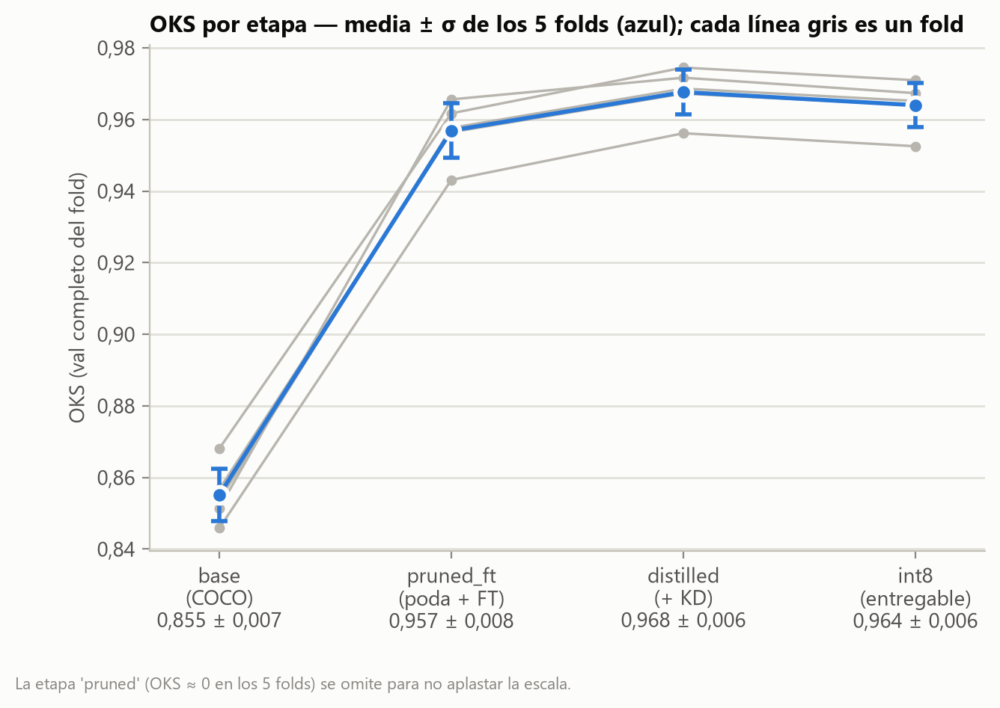
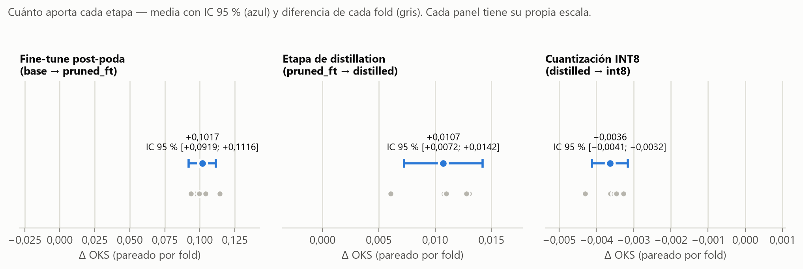
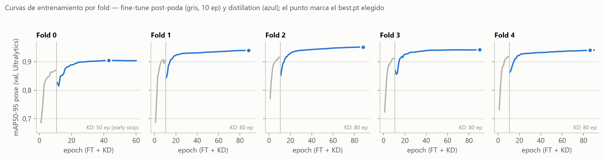
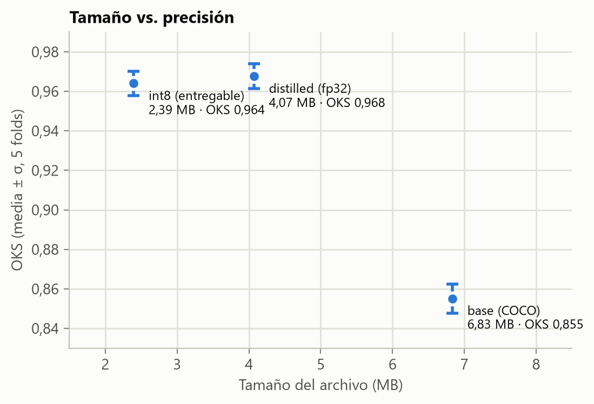

# Resultados — validación cruzada de la Fase 5 (YOLOv8n-pose, 5 folds × 5 etapas)

CV completa con GroupKFold por sujeto (k = 5), terminada el 14-10-2026. Cómo se midió
y qué significa cada métrica: [METODOLOGIA.md](METODOLOGIA.md). Todos los números
salen de [`tablas/`](tablas/) y se regeneran con `scripts/export_fase5_cv_results.py`.

## Resumen

- **El entregable** (YOLOv8n podado 30 % + fine-tune + distillation + INT8) logra
  **OKS 0,964 ± 0,006** y **PCK@0.2 0,998 ± 0,001** sobre sujetos no vistos, con
  **1,91 M de parámetros (−42 %)** y un archivo de **2,39 MB (−65 %)**.
- **El INT8 cuesta −0,0036 OKS** (IC 95 % [−0,0041; −0,0032]), con el mismo signo en
  los 5 folds y PCK sin cambios.
- **La etapa de distillation suma +0,011 OKS** (IC 95 % [+0,007; +0,014], 5/5 folds),
  pero la mejora **no es atribuible a la distillation en sí** (ver §5).
- Los resultados son **estables entre grupos de sujetos**: σ ≈ 0,006–0,008 OKS por
  etapa, y todavía menor en las diferencias pareadas.
- **Ninguno de los 5 modelos pasa la compuerta fuera de dominio**: igual que v2, fallan
  sobre personas y escenas fuera de UCO ([gate_ood/GATE_OOD.md](gate_ood/GATE_OOD.md)).
  Sirven para medir la cadena de optimización, no para desplegar.

## 1. Media ± σ por etapa

σ poblacional sobre los 5 folds; n = 5 en todas las celdas.

| Etapa | OKS | PCK@0.2 | PCK pierna | PCK brazo | Params | Tamaño | Latencia TFLite* |
|---|---|---|---|---|---|---|---|
| base (COCO) | 0,8552 ± 0,0074 | 0,9810 ± 0,0019 | 0,9769 ± 0,0025 | 0,9967 ± 0,0008 | 3.295.470 | 6,83 MB | 44,3 ± 3,2 ms (fp32) |
| pruned | 0,0000 ± 0,0000 | 0,0000 ± 0,0000 | 0,0000 | 0,0000 | 1.907.230 | — | 31,5 ± 2,5 ms (fp32) |
| pruned_ft | 0,9569 ± 0,0076 | 0,9951 ± 0,0028 | 0,9942 ± 0,0036 | 0,9982 ± 0,0005 | 1.907.230 | — | — |
| distilled | 0,9676 ± 0,0063 | 0,9979 ± 0,0011 | 0,9978 ± 0,0015 | 0,9983 ± 0,0005 | 1.907.230 | 4,07 MB | 30,9 ± 0,4 ms (fp32) |
| **int8** | **0,9640 ± 0,0062** | **0,9980 ± 0,0011** | 0,9978 ± 0,0015 | 0,9983 ± 0,0005 | — | **2,39 MB** | 187,0 ± 2,4 ms* |

\* Latencia en la CPU x86 de escritorio. El INT8 dynamic-range corre **más lento** que
el fp32 en x86 (no tiene kernels INT8 optimizados), así que esa celda no representa un
teléfono. Las latencias fp32 sí se pueden comparar entre sí: la poda baja la latencia
~30 % (44,3 → 30,9 ms).

## 2. OKS por fold

| Fold | base | pruned | pruned_ft | distilled | int8 |
|---|---|---|---|---|---|
| 0 | 0,8459 | 0,0000 | 0,9431 | 0,9561 | 0,9525 |
| 1 | 0,8567 | 0,0000 | 0,9564 | 0,9672 | 0,9640 |
| 2 | 0,8681 | 0,0000 | 0,9617 | 0,9745 | 0,9710 |
| 3 | 0,8536 | 0,0000 | 0,9576 | 0,9686 | 0,9652 |
| 4 | 0,8514 | 0,0000 | 0,9656 | 0,9717 | 0,9674 |

El fold 0 (sujetos 4, 11, 14, 19, 20, 23) es el más difícil en todas las etapas. PCK por
fold y el resto de las métricas: `tablas/metricas_por_fold.csv`.

## 3. Cuánto aporta cada etapa (diferencias pareadas por fold)

Cada diferencia se calcula dentro del fold (mismos frames, mismo normalizador) y después
se promedia. IC 95 % con *t* de Student (4 g.l.).

| Transición | Δ OKS por fold (F0 … F4) | Media | IC 95 % | p (t pareado) | Folds con el mismo signo |
|---|---|---|---|---|---|
| base → pruned_ft | +0,097 / +0,100 / +0,094 / +0,104 / +0,114 | **+0,1017** | [+0,0919; +0,1116] | < 0,0001 | 5/5 |
| pruned_ft → distilled | +0,013 / +0,011 / +0,013 / +0,011 / +0,006 | **+0,0107** | [+0,0072; +0,0142] | 0,001 | 5/5 |
| distilled → int8 | −0,0036 / −0,0033 / −0,0035 / −0,0035 / −0,0043 | **−0,0036** | [−0,0041; −0,0032] | < 0,0001 | 5/5 |
| base → int8 (pipeline completo) | +0,107 / +0,107 / +0,103 / +0,112 / +0,116 | **+0,1088** | [+0,1026; +0,1150] | < 0,0001 | 5/5 |

En **PCK@0.2** las dos últimas transiciones no son distinguibles de cero:
pruned_ft → distilled +0,0029, IC [−0,0001; +0,0058] (p = 0,056, 4/5 folds), y
distilled → int8 +0,00003 (p = 0,35). El PCK está casi saturado, así que la mejora sólo
se ve con OKS, que es más fino. Los deltas para todas las métricas y transiciones están
en `tablas/deltas_pareados.csv`.

## 4. Entrenamiento por fold

| Fold | FT: mAP50-95 pose final† | KD: epochs efectivos | KD: mejor epoch | KD: mAP50-95 pose (mejor)† | KD: horas | min/epoch KD |
|---|---|---|---|---|---|---|
| 0 | 0,869 | 50 (early stop) | 33 | 0,904 | 10,5 | 12,6 |
| 1 | 0,905 | 80 | 78 | 0,940 | 16,7 | 12,5 |
| 2 | 0,915 | 80 | 78 | 0,951 | 17,8 | 13,4 |
| 3 | 0,912 | 80 | 80 | 0,942 | 17,1 | 12,9 |
| 4 | 0,918 | 80 | 76 | 0,940 | 17,4 | 13,0 |

† Métrica de validación de Ultralytics, la que elige el `best.pt`. No es el OKS del
evaluador unificado. Sirve para ver la forma de las curvas, no para comparar etapas.

En 4 de los 5 folds la distillation **no se había estancado** al llegar al epoch 80: el
mejor epoch está al final. Con más epochs probablemente seguiría subiendo un poco. Al
inicio de la distillation hay una caída sistemática (cambio de augmentation y reinicio del
warmup) que se recupera en ~5 epochs.

## 5. Qué se puede afirmar y qué no

**Se puede afirmar:**

1. En este dominio (rehabilitación UCO, sujetos no vistos), YOLOv8n-pose se puede podar
   un 30 % de canales (−42 % de parámetros) y cuantizar a INT8 dynamic-range (−65 % de
   tamaño) **terminando con OKS 0,964 y PCK 0,998**. La conclusión se repite en los 5
   folds.
2. **La poda sin recuperación destruye el modelo** (OKS 0 en los 5 folds: deja de
   detectar personas). El fine-tune posterior lo recupera por completo en 10 epochs.
3. **El costo del INT8 es pequeño y muy predecible**: −0,0036 ± 0,0004 OKS por fold, sin
   cambio en PCK.

**No se puede afirmar todavía:**

1. **Que la compresión no pierde precisión respecto de un modelo sin comprimir entrenado
   en UCO.** El `base` es COCO sin adaptar. El +0,10 de `base → pruned_ft` mezcla la
   recuperación de la poda con la **adaptación de dominio**. El número que falta es el
   baseline de la Fase 1: YOLOv8n sin podar, entrenado en UCO con la misma receta.
2. **Que la distillation ayude.** El +0,011 de la etapa `distilled` reúne cuatro cosas:
   (a) el fine-tune de 10 epochs dejó la recuperación incompleta; (b) la etapa suma 50–80
   epochs de entrenamiento supervisado; (c) cambia la augmentation (vuelve el mosaic);
   (d) el término de imitación pesa ~2–3 % de la loss. Además el maestro (yolov8x-pose
   COCO, OKS ~0,91 medido sobre una muestra del fold 0) es **peor** que el estudiante
   en este dominio. El control que separa los efectos es la misma etapa con α = 1 (sin
   imitación).
3. **La precisión contra anotación humana.** La referencia son pseudo-labels de
   ViTPose-H (ver METODOLOGIA §7).
4. **La latencia en el teléfono.**

**Se midió y da negativo: ningún modelo de la CV es desplegable.** En la compuerta fuera
de dominio (imágenes COCO con GT real, el criterio de aceptación del informe) los 5
modelos fallan igual que v2. Detectan a la persona en el 31 % ± 11 % de las imágenes con
el umbral de la app (v3: 98 %), el error de punto es 0,42 ± 0,09 de la diagonal (v3:
0,04; criterio ≤ 0,05) y el 38 % de las imágenes evaluables colapsan. La versión fp32
también falla, así que no es la cuantización. Detalle en
[gate_ood/GATE_OOD.md](gate_ood/GATE_OOD.md). Los números de este documento
caracterizan la cadena de optimización **dentro de UCO**; el artefacto desplegable sigue
siendo v3.

## 6. Advertencias para citar estos números

- **"GT" = pseudo-labels ViTPose-H.** El OKS mide el acuerdo con ViTPose-H.
- **OKS medio, no AP de COCO**, y normalizado por el área del bbox de persona. No se
  compara con los valores de los papers.
- **Sesgo optimista por selección de modelo** en `pruned_ft`, `distilled` e `int8`: el
  `best.pt` se elige sobre el mismo `val` en el que se reporta. Probablemente chico
  (curvas planas al final), pero no está cuantificado.
- **8 reanudaciones durante la corrida**: no cambian pesos ni optimizer, pero sí el RNG de
  augmentation y el contador del early stopping.
- **Latencia de escritorio**, no del dispositivo.
- **n = 5 folds**: los IC son anchos y los p-valores dependen de supuestos (normalidad
  de las diferencias) difíciles de verificar con 5 puntos. La señal más robusta es el
  signo consistente en 5/5 folds.

## 7. Qué completaría el análisis (por impacto en el informe)

1. **Baseline Fase 1 en UCO** (sin podar, misma receta): aísla el costo real de la
   compresión.
2. **Evaluación contra el gold humano de CVAT** (aunque sea sobre un subconjunto): mide el
   error contra anotación real y el sesgo de ViTPose-H.
3. **Latencia y consumo en el teléfono Android destino.**
4. **Control α = 1** de la etapa de distillation, si se quiere afirmar algo sobre la KD.
5. **Repetir la CV con la receta mixta UCO + COCO de v3**, si se quieren números de CV de
   un modelo que además pase la compuerta OOD. Los de este documento no la pasan
   ([gate_ood/GATE_OOD.md](gate_ood/GATE_OOD.md)).
