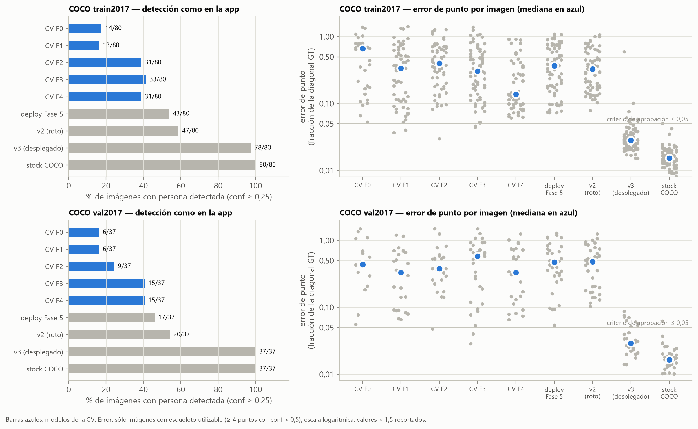
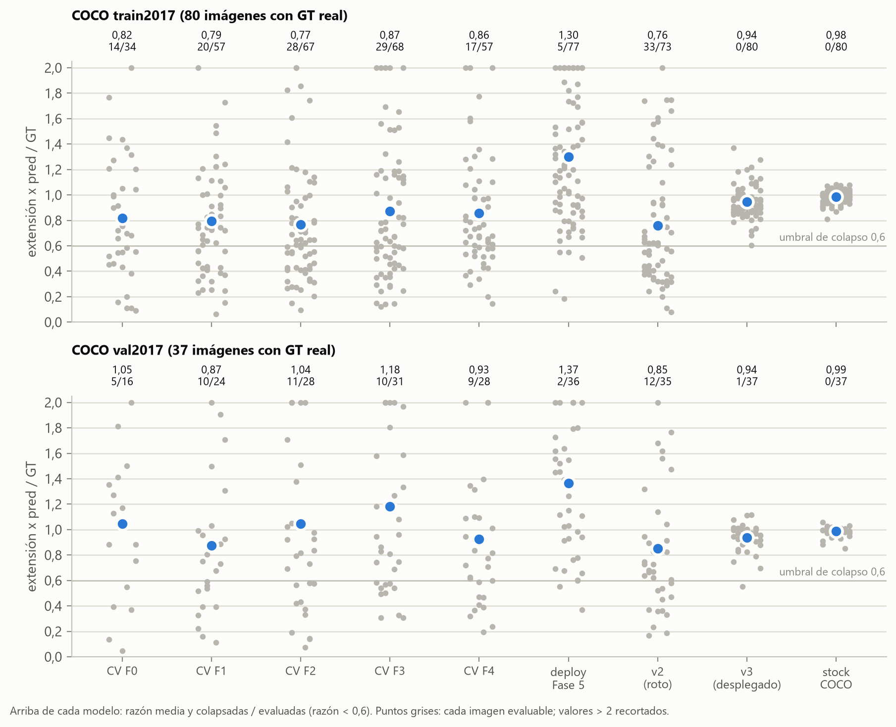

# Compuerta fuera de dominio (OOD) — modelos de la CV de la Fase 5

El informe (sec. `artefacto_generalizacion`) fija la compuerta fuera de dominio como
condición de aceptación de cualquier modelo desplegable, en paralelo al OKS. Los
modelos de la CV se entrenaron sólo con UCO, igual que v2, que colapsó en la app con
OKS 0,931 dentro del dominio. Este documento aplica esa compuerta a los 5 `.tflite`
INT8 de la CV.

## Veredicto

**Los 5 modelos de la CV no pasan la compuerta.** Reproducen la falla de v2, y en
detección son peores:

| Criterio (set train2017, 80 imágenes) | Aprobado si | CV, 5 folds: media ± σ [rango] | v2 (roto) | v3 (desplegado) | stock COCO |
|---|---|---|---|---|---|
| Extensión horizontal pred/GT (media) | ≥ ~0,9 | 0,82 ± 0,04 [0,77–0,87] | 0,76 | 0,94 | 0,98 |
| Imágenes colapsadas (razón < 0,6) | ~0–1 | 38 % ± 5 % [14/34 – 29/68] | 33/73 | 0/80 | 0/80 |
| Error de punto (fracción de la diagonal GT) | ≤ ~0,05 | 0,42 ± 0,09 [0,27–0,56] | 0,39 | 0,039 | 0,017 |
| Persona detectada con el umbral de la app (0,25) | — | 31 % ± 11 % [13–33 de 80] | 47/80 | 78/80 | 80/80 |
| OKS dentro del dominio (UCO) | — | 0,964 ± 0,006 | 0,931 | 0,941 | — |

Fuera de UCO, en el 59–84 % de las imágenes el modelo de la CV **no detecta a la
persona** con el umbral de la app. Cuando la detecta, el esqueleto queda **fuera del
cuerpo**: el error medio es 0,42 de la diagonal, unas 8 veces el criterio, y 38 % de
las imágenes evaluables están colapsadas. La razón media "casi bien" (0,82) es
engañosa, porque promedia esqueletos demasiado angostos con otros demasiado anchos.
Lo que separa sin ambigüedad a los modelos que sirven de los que no es el error de punto
(figura [`compuerta_ood.png`](compuerta_ood.png)).

El resultado se repite en val2017, un set que ni el modelo stock ni los modelos de la CV
vieron nunca: error 0,49 ± 0,07, 35 % de colapsadas, detección 28 % ± 11 % (tabla
completa en §4).

**Lectura para el informe:** el OKS de 0,964 de la CV mide bien lo que la poda, el
fine-tune, la distillation y la cuantización le hacen al modelo **dentro de UCO**, pero no
habilita a desplegar ninguno de esos modelos. El único linaje que pasa la compuerta sigue
siendo v3, entrenado sobre una mezcla UCO + COCO. Los modelos de la CV caracterizan la
cadena de optimización; v3 es el artefacto. Es el mismo argumento metodológico que la
sección ya hace con v2, ahora con 5 modelos más en la misma dirección.



## 1. Qué mide la compuerta

`scripts/diagnose_kpt_ratio.py --gt-set` (función `gate_gt_set`) corre cada modelo sobre
imágenes externas con anotación humana real, con un decode **idéntico al de la app**
(`tf.lite.Interpreter`, letterbox de la app, salida cruda `[1, 56, 8400]`, sin
Ultralytics). Por imagen toma la detección de mayor confianza y mide:

| Métrica | Definición |
|---|---|
| Extensión horizontal pred/GT | (máx − mín de la x de los keypoints predichos con conf > 0,5) / ancho del bbox GT, dividido por lo mismo calculado sobre el GT. 1,0 = ancho correcto; < 0,6 = **colapsado** |
| Error de punto | Distancia media entre keypoints predichos y GT (presentes en ambos), en fracción de la diagonal del bbox GT |
| Imágenes evaluables | Las que tienen GT con ≥ 4 keypoints y una detección con ≥ 4 keypoints de conf > 0,5. Las demás no entran a la razón ni al error: son imágenes **sin esqueleto utilizable** |
| Detección con el umbral de la app | Imágenes donde la mejor detección tiene confianza ≥ 0,25, el umbral de la app y del evaluador. La compuerta original no aplica umbral, así que un modelo que "detecta" con confianza 0,01 cuenta como detectado. Esta columna dice qué vería el paciente |

Todo se normaliza por el bbox **GT**, nunca por el predicho: un modelo roto también
predice un bbox malo y eso esconde el colapso.

## 2. El set de imágenes (reconstruido)

El set original de 79 imágenes de COCO train2017 (julio de 2026) **se perdió**: no quedó
ni la lista de IDs ni el script que lo armó. Se reconstruyó con criterios explícitos
(`scripts/build_ood_gt_set.py`), y la lista de IDs quedó **versionada** en
`data/ood_gate/`, para que no vuelva a pasar.

Criterios, aplicados sobre las anotaciones oficiales `person_keypoints_*.json`:

1. exactamente **una** persona anotada en la imagen (no *crowd*);
2. los **17 keypoints** anotados, y los 12 del cuerpo (hombros a tobillos) visibles:
   **cuerpo entero**;
3. **grande**: el bbox ocupa ≥ 50 % de la altura de la imagen;
4. **de pie**: bbox más alto que ancho;
5. **de frente**: el hombro y la cadera izquierdos aparecen a la derecha de los derechos,
   y el ancho de hombros es ≥ 30 % del ancho del bbox.

| Set | Candidatas | Usadas | Quién ya vio estas imágenes |
|---|---|---|---|
| `train2017` | 578 | 80 (semilla 0) | El YOLOv8n-pose de partida (pre-entrenamiento COCO). Es el split del set original y sobre él se calibraron los umbrales |
| `val2017` | 37 | 37 (todas) | Ninguno de los modelos UCO-only ni el stock. **v3 sí**: su fine-tune mezcla COCO val2017, así que su fila de val2017 no es fuera de dominio |

### Validación: el set reconstruido reproduce al original

Las tres referencias, medidas otra vez sobre el set nuevo, dan los mismos veredictos que
en julio, con números muy cercanos:

| Modelo | Original (79 imgs, jul-2026) | Reconstruido (80 imgs, train2017) |
|---|---|---|
| v2 | 0,701 · 40/76 colapsadas · error 0,314 | 0,759 · 33/73 · error 0,393 |
| v3 | 0,913 · 1/79 · error 0,049 | 0,945 · 0/80 · error 0,039 |
| stock COCO | 0,977 · 0/79 · error 0,022 | 0,984 · 0/80 · error 0,017 |

El set nuevo es apenas más "fácil" en extensión (+0,03 a +0,06 en las tres referencias) y
algo más exigente en error para v2. El orden y los veredictos (v2 falla, v3 y stock
pasan) se mantienen. El decode también se verificó: el control stock da 0,564 de
extensión sobre `bus.jpg`, el mismo valor registrado en julio.

## 3. Modelos evaluados

| Etiqueta | Qué es |
|---|---|
| `cv_fold{k}_int8` | El entregable INT8 de cada fold de la CV (`../modelos/fold{k}_int8.tflite`) |
| `cv_fold{k}_fp32` | El `best.pt` de la distillation del mismo fold (para descartar la cuantización) |
| `deploy_fase5_int8` | El modelo del config de deploy de la Fase 5 (`fase5-deploy`, run `42c1c36d`: FT 25 + KD 20, sólo UCO). Tampoco había pasado la compuerta |
| `deploy_v2_int8` | v2: sólo UCO, roto en la app (referencia negativa) |
| `deploy_v3_int8` | v3: mezcla UCO + COCO, el desplegado (referencia positiva) |
| `stock_coco_int8` | YOLOv8n-pose COCO sin tocar (techo) |

## 4. Resultados completos

**train2017 (80 imágenes):**

| Modelo | Razón media | Razón mediana | Colapsadas / evaluables | Sin esqueleto | Error de punto | Detección (conf ≥ 0,25) |
|---|---|---|---|---|---|---|
| CV F0 INT8 | 0,82 | 0,71 | 14/34 | 46 | 0,557 | 14/80 |
| CV F1 INT8 | 0,79 | 0,74 | 20/57 | 23 | 0,408 | 13/80 |
| CV F2 INT8 | 0,77 | 0,65 | 28/67 | 13 | 0,446 | 31/80 |
| CV F3 INT8 | 0,87 | 0,70 | 29/68 | 12 | 0,412 | 33/80 |
| CV F4 INT8 | 0,86 | 0,73 | 17/57 | 23 | 0,265 | 31/80 |
| deploy Fase 5 INT8 | 1,30 | 1,16 | 5/77 | 3 | 0,430 | 43/80 |
| v2 INT8 (roto) | 0,76 | 0,62 | 33/73 | 7 | 0,393 | 47/80 |
| v3 INT8 (desplegado) | 0,94 | 0,92 | 0/80 | 0 | 0,039 | 78/80 |
| stock COCO INT8 | 0,98 | 0,99 | 0/80 | 0 | 0,017 | 80/80 |

**val2017 (37 imágenes):**

| Modelo | Razón media | Razón mediana | Colapsadas / evaluables | Sin esqueleto | Error de punto | Detección (conf ≥ 0,25) |
|---|---|---|---|---|---|---|
| CV F0 INT8 | 1,05 | 1,01 | 5/16 | 21 | 0,589 | 6/37 |
| CV F1 INT8 | 0,87 | 0,74 | 10/24 | 13 | 0,413 | 6/37 |
| CV F2 INT8 | 1,04 | 0,80 | 11/28 | 9 | 0,476 | 9/37 |
| CV F3 INT8 | 1,18 | 0,86 | 10/31 | 6 | 0,545 | 15/37 |
| CV F4 INT8 | 0,93 | 0,75 | 9/28 | 9 | 0,445 | 15/37 |
| deploy Fase 5 INT8 | 1,37 | 1,21 | 2/36 | 1 | 0,531 | 17/37 |
| v2 INT8 (roto) | 0,85 | 0,68 | 12/35 | 2 | 0,497 | 20/37 |
| v3 INT8\* | 0,94 | 0,96 | 1/37 | 0 | 0,036 | 37/37 |
| stock COCO INT8 | 0,99 | 1,00 | 0/37 | 0 | 0,019 | 37/37 |

\* v3 vio val2017 en su fine-tune: esta fila no es fuera de dominio para v3.

Las filas fp32 (`cv_fold{k}_fp32`) están en `resumen.csv`. Con el camino de Ultralytics,
que aplica el umbral 0,25, detectan en sólo 14–40 de 80 imágenes, y donde detectan el
error es igual de alto (0,24–0,49). **No es la cuantización**: el pesado fp32 ya
falla, igual que pasó con v2.



## 5. Observaciones

1. **El modo de falla incluye esqueletos anchos, no sólo angostos.** v2 colapsaba
   "angosto" (razón 0,62 mediana). Los modelos de la CV y el deploy de la Fase 5 producen
   tanto esqueletos angostos como demasiado anchos (deploy Fase 5: razón 1,30, pero error
   0,43). Por eso la razón sola no alcanza como criterio y el error de punto es el
   indicador decisivo. Conviene que el informe lo diga si cita la razón.
2. **Cuanto más entrenamiento sólo-UCO, peor detección fuera del dominio**, al menos en
   estos 3 linajes: v2 (FT 25 epochs) detecta 47/80; deploy Fase 5 (FT 25 + KD 20) 43/80;
   CV (FT 10 + KD 50–80) 13–33/80. Es consistente con un olvido progresivo de COCO, pero
   son 3 recetas que difieren en más de una cosa: es una observación, no un efecto medido.
3. **La distillation con un maestro COCO no evitó el olvido.** El maestro (yolov8x-pose)
   es un modelo de dominio general, pero el término de imitación pesa ~2–3 % de la loss
   (ver `../METODOLOGIA.md`) y la tarea supervisada es sólo UCO. Lo que restauró la
   generalidad en v3 fue mezclar imágenes COCO en los datos, no el maestro.
4. Las overlays de `overlays/` (3 modelos × 4 imágenes por set) son la evidencia visual:
   el esqueleto de CV F0 cae sobre el piso o fuera de la persona, como el de v2.

## 6. Limitaciones

- **Set chico** (80 + 37 imágenes) y **sesgado a propósito** hacia las condiciones de la
  app (una persona grande, de pie, de frente). No mide la generalización en general, sino
  en el caso de uso.
- **train2017 no es estrictamente nuevo** para el modelo de partida, que se
  pre-entrenó en COCO train2017. Para el stock es un techo optimista. val2017 no tiene
  ese problema y da el mismo veredicto.
- **No es el set original de julio.** Los números de v2/v3/stock difieren en ±0,03–0,08
  de los publicados en la Tabla `tab:compuerta_generalizacion` del informe; los
  veredictos no cambian.
- Los umbrales de aprobación (≥ ~0,9; ≤ ~0,05) son los de la guía del repo
  (`.github/skills/gate-deploy-checkpoint/SKILL.md`), calibrados con v2 y v3; no son un
  estándar externo.

## 7. Archivos y cómo regenerar

| Archivo | Contenido |
|---|---|
| `resumen.csv` | Una fila por set × modelo con todas las métricas |
| `por_imagen.csv` | Una fila por set × modelo × imagen (score, razón, error, motivo si no es evaluable) |
| `gate_train2017.json`, `gate_val2017.json` | Lo mismo en JSON, tal como lo devuelve `gate_gt_set` |
| `compuerta_ood.png` | Detección con el umbral de la app + error de punto por imagen |
| `razon_por_modelo.png` | La razón de extensión (la métrica de la tabla del informe) por imagen |
| `overlays/` | Esqueleto predicho vs GT sobre imágenes de ejemplo |
| `fragmento_informe.tex` | Párrafo y tabla listos para la sección `artefacto_generalizacion` |

```
# 1. Imágenes + labels (una vez; los IDs ya están en data/ood_gate/)
python scripts/build_ood_gt_set.py --annotations-dir <dir con person_keypoints_*.json>
# 2. Compuerta sobre todos los modelos (venv-torch, ~5 min)
venv-torch\Scripts\python.exe scripts\run_ood_gate_fase5.py
```

Las anotaciones `person_keypoints_{train,val}2017.json` vienen en
`annotations_trainval2017.zip` (images.cocodataset.org, 241 MB).
